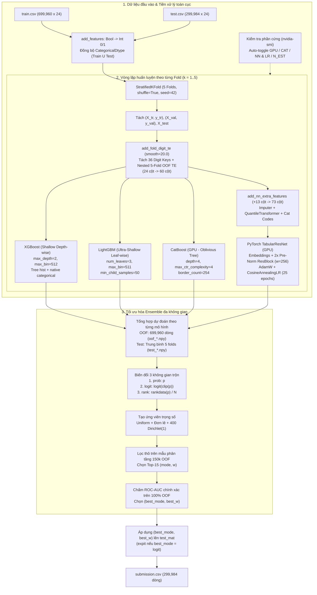
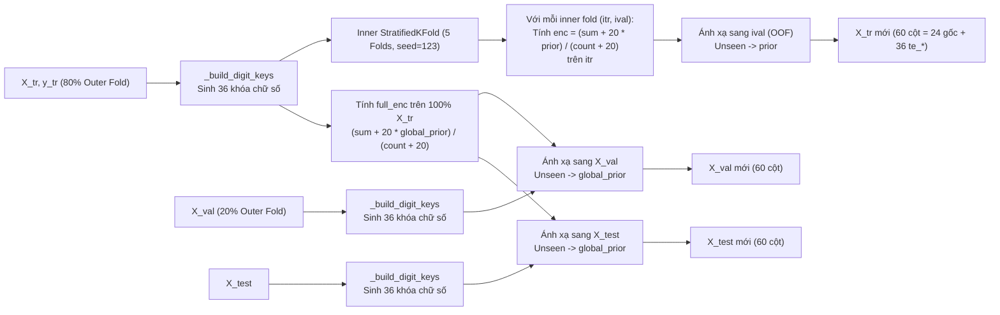
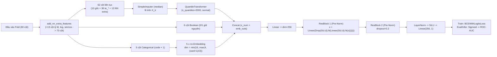
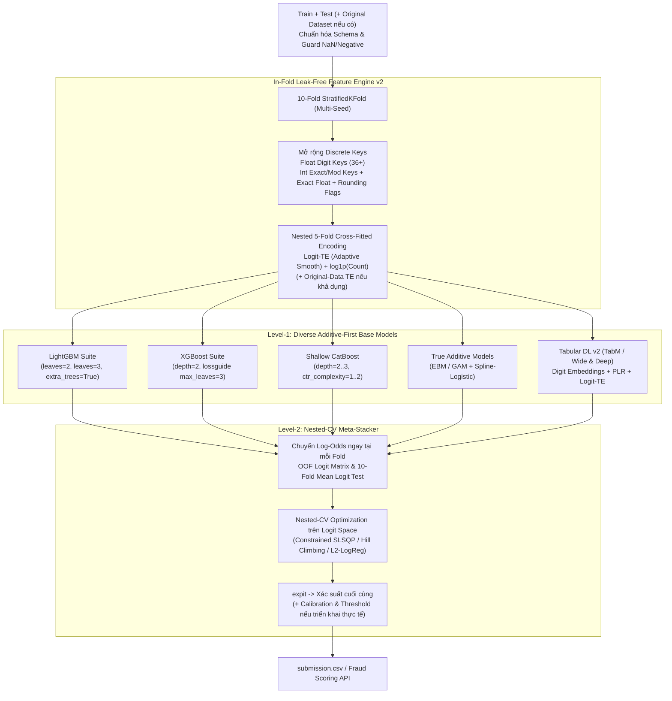

# Kiến trúc Hệ thống Học máy — Phát hiện Gian lận Thẻ tín dụng (Kaggle S6E11)

Tài liệu này mô tả chi tiết kiến trúc thuật toán học máy hiện tại của dự án (triển khai mới nhất tại [`notebooka55f0b78be.ipynb`](notebooka55f0b78be.ipynb), đạt mốc **Kaggle LB `0.95015`**), giải thích vai trò của từng thành phần, phân tích điểm nghẽn trực tiếp từ mã nguồn và đề xuất lộ trình cải tiến.

---

## 1. Tổng quan bài toán & Dữ liệu

- **Bài toán:** Phân loại nhị phân phát hiện giao dịch gian lận thẻ tín dụng (`is_fraud` $\in \{0, 1\}$) — *Kaggle Playground Series S6E11*.
- **Metric tối ưu:** `ROC-AUC` (đánh giá năng lực xếp hạng xác suất rủi ro trên tập dữ liệu mất cân bằng mạnh).
- **Quy mô dữ liệu:**
  - `data/train.csv`: `699,960` giao dịch, `24` đặc trưng gốc + `id` + `is_fraud` (tỷ lệ dương tính ~`1.67%`).
  - `data/test.csv`: `299,984` giao dịch, `24` đặc trưng gốc + `id`.
- **Quá trình tiến hóa kiến trúc trong repo:**
  - [`code.py`](code.py): Baseline tuyến tính `LinearSVC` hiệu chỉnh xác suất (38 cột) $\rightarrow$ `0.94294`.
  - [`test.ipynb`](test.ipynb): Ensemble GBDT (`XGB + LGB`) + 7 đặc trưng tổng hợp nhóm (31 cột) $\rightarrow$ `0.94711`.
  - [`notebooka55f0b78be.ipynb`](notebooka55f0b78be.ipynb) *(kiến trúc hiện tại)*: **Shallow Trees + 36 Digit-Key Cross-fitted Target Encoding (60 cột) + Heterogeneous 4-Model Ensemble + Multi-Space Logit Blend** $\rightarrow$ **LB `0.95015`**.

---

## 2. Sơ đồ kiến trúc thuật toán hiện tại

### 2.1. Kiến trúc tổng thể (End-to-End Pipeline)



---

### 2.2. Luồng chống Data Leakage trong `add_fold_digit_te`



---

### 2.3. Kiến trúc chi tiết nhánh Deep Learning (`TabularResNet`)



---

## 3. Giải thích chi tiết từng thành phần

### 3.1. Lớp dữ liệu & Cấu trúc 24 đặc trưng gốc

24 đặc trưng đầu vào được phân loại thành 5 nhóm xử lý khác nhau trong mã nguồn:

| Nhóm cột | Số lượng | Danh sách cột | Cách xử lý trong kiến trúc hiện tại |
| :--- | :---: | :--- | :--- |
| **Float 2 số lẻ (`FLOAT_COLS_2D`)** | `4` | `amount_usd`, `hours_since_last_txn`, `distance_from_home_km`, `account_balance_usd` | Giữ nguyên giá trị số + tách thành `28` Digit Keys (`7` khóa/cột) để tính OOF TE |
| **Float 1 số lẻ (`FLOAT_COLS_1D`)** | `2` | `velocity_score`, `merchant_risk_score` | Giữ nguyên giá trị số + tách thành `8` Digit Keys (`4` khóa/cột) để tính OOF TE |
| **Số nguyên rời rạc (Int)** | `7` | `txn_count_last_24h`, `card_age_months`, `customer_age`, `cvv_retry_count`, `time_of_day_hour`, `day_of_week`, `prior_disputes` | Đưa trực tiếp vào GBDT; riêng NN bổ sung biến đổi `sin/cos` cho `time_of_day_hour` và `day_of_week` |
| **Cờ nhị phân (`BOOL_COLS`)** | `6` | `is_foreign_transaction`, `is_new_merchant`, `used_vpn`, `ip_country_mismatch`, `billing_shipping_mismatch`, `is_ai_generated_scam_attempt` | Chuyển `bool -> int` (`0/1`), giữ nguyên không qua `QuantileTransformer` ở nhánh NN |
| **Phân loại (`CAT_COLS`)** | `5` | `merchant_category`, `card_type`, `auth_method`, `channel`, `device_type` | Đồng bộ danh mục `train U test` thành `CategoricalDtype`; xử lý native trên XGB/LGB/CAT và qua `nn.Embedding` trên NN |

---

### 3.2. Tự động thích ứng phần cứng & Quản lý vòng đời huấn luyện

- **Phát hiện dữ liệu (`find_data_dir`):** Tự động dò đường dẫn trong Kaggle (`/kaggle/input/...`) hoặc thư mục cục bộ `data/`.
- **Thích ứng GPU/CPU (`USE_GPU`):** Kiểm tra `nvidia-smi` để quyết định tự động:
  - **Trên CPU:** Chỉ chạy `XGB + LGB` với `LR=0.04`, `N_EST=5000`, `EARLY_STOP=100` để đảm bảo thời gian chạy thực tế (~4–5 phút).
  - **Trên GPU (Kaggle):** Tự động bật đủ 4 mô hình (`XGB + LGB + CAT + NN`), giảm tốc độ học (`LR=0.025`), tăng số vòng tối đa (`N_EST=8000`, `EARLY_STOP=150`) để hội tụ mịn hơn.

---

### 3.3. Thành phần đột phá: Digit-Key Decomposition & Nested Cross-Fitted TE (`add_fold_digit_te`)

Đây là thành phần mang lại bước nhảy lớn nhất trong toàn bộ lịch sử dự án (**`+0.00287` Kaggle LB**, từ `0.94728` lên `0.95015`).

1. **Phân rã 36 khóa chữ số (`_build_digit_keys`):**
   - Với `4` cột `FLOAT_COLS_2D` ($28$ khóa): phần nguyên (`__int`), phần xu (`__cents = round(x*100) % 100`), hàng phần mười (`__tenths`), hàng phần trăm (`__hundredths`), hàng đơn vị (`__ones`), hàng chục (`__tens`), chữ số dẫn đầu (`__lead = floor(x / 10^floor(log10(x)))`).
   - Với `2` cột `FLOAT_COLS_1D` ($8$ khóa): `__int`, `__tenths`, `__ones`, `__tens`.
2. **Mã hóa mục tiêu làm mượt M-estimate (`smooth = 20.0`):**
   $$\text{TE}(k) = \frac{\sum_{i: \text{key}_i = k} y_i + m \cdot \bar{y}}{n_k + m}, \quad m = 20.0$$
   Công thức này kéo ước lượng của các khóa xuất hiện ít ($n_k$ nhỏ) về xác suất tiên nghiệm $\bar{y} \approx 0.0167$, chống quá khớp cho các khóa có lực lượng lớn như `amount_usd__int`.
3. **Cơ chế Cross-fitting 2 tầng (Nested 5-Fold):**
   - Khóa `X_tr` không bao giờ tự dùng nhãn `y_tr` của chính dòng đó để tính TE: bên trong mỗi Outer Fold, `X_tr` tiếp tục bị chia thành `5` Inner Folds (`random_state=123`) để tính OOF TE.
   - `X_val` và `X_test` nhận bảng ánh xạ fit trên `100%` tập `X_tr` của Outer Fold tương ứng.
4. **Lý do kỹ thuật này hoạt động mạnh trên dữ liệu S6E11:**
   - Các tập dữ liệu Kaggle Playground Series thường được sinh tổng hợp (synthetic data) từ mô hình sinh sâu học trên dữ liệu thực, để lại các mẫu phân bố phi đơn điệu ở cấp độ chữ số (ví dụ: đuôi `.99`, số tròn chục, chữ số dẫn đầu theo định luật Benford hoặc artifact rời rạc hóa của mô hình sinh).
   - Cây quyết định tiêu chuẩn chỉ cắt theo ngưỡng liên tục ($x \le t$), nên **không thể tự tách** các tín hiệu tuần hoàn/rời rạc như `x % 10 == 9` hay `cents == 99`. Việc chuyển 36 Digit Keys sang xác suất gian lận có điều kiện (`te_*`) biến tín hiệu phi tuyến rời rạc này thành 36 biến liên tục đơn điệu mà cây rất nông dễ dàng khai thác.

---

### 3.4. Hệ thống 4 mô hình nền (Heterogeneous Base Learners)

Qua thực nghiệm ablation (xem [`improvement_history.md`](improvement_history.md)), tín hiệu chính của bài toán mang **cấu trúc cộng tính mạnh (additive structure)** — thể hiện qua việc `LinearSVC` đã đạt `0.94294` và việc giảm độ sâu cây giúp tăng AUC đáng kể.

| Mô hình | Họ thuật toán | Cấu hình lõi (GPU) | Cơ chế đặc trưng | Vai trò trong Ensemble |
| :--- | :--- | :--- | :--- | :--- |
| **XGBoost** (`build_xgb`) | Depth-wise GBDT (`hist`) | `max_depth=2`, `min_child_weight=20`, `colsample=0.70`, `L1=2, L2=10`, `max_bin=512` | Tối đa 4 lá/cây (tương tác bậc $\le 2$), tối ưu trực tiếp trên histogram mịn 512 bin | Trụ cột chính cùng LGB (`0.94835` trên Fold 1) |
| **LightGBM** (`build_lgb`) | Leaf-wise GBDT | `num_leaves=3`, `min_child_samples=50`, `subsample=0.8 (freq=1)`, `max_bin=511` | Cây cực nông 3 lá (gần như cộng tính thuần + tối đa 1 tương tác bậc 2), chống học nhiễu tối đa | Mô hình đơn lẻ mạnh nhất (`0.94846` trên Fold 1) |
| **CatBoost** (`build_cat`) | Oblivious (Symmetric) GBDT | `depth=4`, `lr=0.03`, `l2_leaf_reg=10`, `border_count=254`, `max_ctr_complexity=4` | Cây đối xứng dùng chung điều kiện cắt trên mỗi tầng + Online Target Statistics cho `CAT_COLS` | Tạo đa dạng cấu trúc cây đối xứng (nhưng đang còn sâu so với bản chất dữ liệu) |
| **TabularResNet** (`train_predict_nn`) | Deep Learning (PyTorch) | `width=256`, `2x ResBlock (dropout=0.2)`, `QuantileTransformer`, `AdamW + CosineLR` | Học biểu diễn liên tục trơn qua Embedding + Residual skip-connection trên `73` cột (`+13` cột tỷ lệ/chu kỳ) | Bổ sung đa dạng phi cây (non-tree diversity), tuy điểm đơn lẻ hiện thấp hơn GBDT |

---

### 3.5. Bộ tối ưu hóa Ensemble đa không gian

- **Ba không gian kết hợp (Blending Spaces):**
  1. **Probability (`prob`):** $\hat{y} = \sum_j w_j p_j$ — phù hợp khi các mô hình đã được hiệu chỉnh xác suất (calibrated) đồng đều.
  2. **Logit / Log-odds (`logit`):** $\hat{y} = \sigma\left(\sum_j w_j \ln\frac{p_j}{1 - p_j}\right)$ — **tự nhiên nhất cho bài toán mất cân bằng (`1.67%`)** và mô hình cộng tính, vì log-odds tuyến tính hóa vùng xác suất sát $0$ và $1$ (tránh việc xác suất cực nhỏ bị nuốt mất khi cộng trung bình).
  3. **Rank (`rank`):** $\hat{y} = \sum_j w_j \frac{\text{rank}(p_j)}{N}$ — bất biến với sai lệch hiệu chỉnh xác suất giữa các họ mô hình (đặc biệt khi kết hợp NN và GBDT).
- **Tìm trọng số 2 tầng:** Sinh $401 + m$ vector trọng số (đều nhau + đơn lẻ + `400` mẫu `Dirichlet(1)`), chấm nhanh trên mẫu phân tầng `150,000` dòng OOF để lọc **Top-15**, sau đó đánh giá chính xác trên toàn bộ `699,960` dòng OOF để chọn `(best_mode, best_w)` tối ưu nhất cho `submission.csv`.

---

## 4. Phân tích hạn chế & Điểm nghẽn hiện tại (Audit từ mã nguồn)

Kiểm tra trực tiếp [`notebooka55f0b78be.ipynb`](notebooka55f0b78be.ipynb) cho thấy **6 điểm nghẽn / lỗi tinh vi** đang kìm hãm tiềm năng của mô hình:

1. **CatBoost chưa được đồng bộ theo phát hiện "Shallow Additive Trees"** *(dòng 243–256)*:
   - Trong khi `XGB` (`max_depth=2`, 4 lá) và `LGB` (`num_leaves=3`, 3 lá) đã nhảy vọt lên `~0.9484`, `CatBoost` vẫn giữ `depth=4` (16 lá/cây) và `max_ctr_complexity=4` (tổ hợp 4 biến phân loại bậc cao) cùng `border_count=254`. Điều này khiến CatBoost dễ overfit các tương tác nhiễu và tụt hậu đáng kể so với XGB/LGB.
2. **Thiết kế nhánh `TabularResNet` chưa tối ưu cho tín hiệu Digit-Key & cấu trúc cộng tính** *(dòng 259–376)*:
   - Đưa `36` cột `te_*` đi qua `QuantileTransformer(output_distribution="normal")` làm **biến dạng thang đo log-odds** vốn đã chứa thông tin xác suất gian lận tuyến tính của Target Encoding.
   - Chưa đưa trực tiếp `36` Digit Keys vào dạng `nn.Embedding` để mạng tự học biểu diễn chung.
   - Kiến trúc MLP/ResNet tiêu chuẩn có xu hướng học tương tác bậc cao dày đặc (dense high-order interactions) nên kém hiệu quả hơn kiến trúc cộng tính hoặc kiến trúc có **Numerical Periodic Embeddings (PLR)**.
3. **Feature Engineering mới khai thác 6/24 cột gốc và dùng `smooth=20.0` đồng nhất** *(dòng 112–171)*:
   - `7` cột số nguyên (`customer_age`, `card_age_months`, `time_of_day_hour`, `day_of_week`, `txn_count_last_24h`, `cvv_retry_count`, `prior_disputes`) và giá trị gốc chính xác (exact value) của các cột số thực chưa có OOF TE / Frequency Encoding.
   - Tham số `smooth=20.0` dùng chung cho cả khóa có 10 giá trị (`__tens`) lẫn khóa có hàng nghìn giá trị (`__int`, `account_balance_usd__int`), và chưa kèm biến đếm tần suất (`log1p(count)`) để cây phân biệt ước lượng TE đáng tin cậy với ước lượng nhiễu.
   - Trong `_build_digit_keys`, giá trị `NaN` hoặc số âm (nếu xuất hiện) chưa được xử lý tường minh trước khi ép kiểu `np.int64` và tính `% 10` / `log10`.
4. **Tối ưu Ensemble thiếu Nested CV & sai lệch thứ tự biến đổi `logit` trên tập test** *(dòng 423–523)*:
   - `test_preds[m]` được lấy **trung bình số học ở không gian xác suất** qua 5 folds (`+= predict_proba / 5`), sau đó mới lấy `logit(test_mat)` ở cuối — về mặt toán học $\text{logit}\left(\frac{1}{5}\sum p_k\right) \ne \frac{1}{5}\sum \text{logit}(p_k)$, gây lệch nhẹ ở vùng xác suất sát $0$.
   - Tìm trọng số bằng 400 mẫu Dirichlet ngẫu nhiên khá thô và chấm trực tiếp trên OOF (dễ hơi lạc quan/overfit trọng số khi thêm nhiều mô hình).
   - **Lỗi nhỏ ở dòng 515:** khi `best_mode == "rank"`, biến `oof_ens` dùng để in `classification_report` vẫn tính `oof_mat @ best_w` thay vì `rank_mat @ best_w` (không ảnh hưởng `submission.csv`, chỉ ảnh hưởng log báo cáo).
5. **Phương sai CV & Độ ổn định huấn luyện:**
   - Mới dùng `5-Fold` với `1` random seed duy nhất (`42`). Với các khóa Digit TE có cardinality cao (`amount_usd__int`, `account_balance_usd__int`), dùng 5-fold khiến mỗi fold chỉ học trên 80% dữ liệu (và inner fold chỉ trên 64% dữ liệu!).
6. **Khả năng bảo trì & tái lập thí nghiệm:**
   - Toàn bộ pipeline nằm trong một notebook đơn khối (`notebooka55f0b78be.ipynb`), chưa tách module, chưa có chế độ chạy nhanh 1-fold ablation bằng cờ cấu hình, chưa lưu metadata/config thí nghiệm tự động.

---

## 5. Đề xuất hướng cải tiến (Roadmap v2)

### 5.1. Ma trận ưu tiên cải tiến

| Ưu tiên | Nhóm cải tiến | Hành động cụ thể | Kỳ vọng tác động ROC-AUC | Chi phí triển khai |
| :---: | :--- | :--- | :---: | :---: |
| **P1** | **Mở rộng Digit/Exact-Value TE & Encoding** | Thêm OOF TE/Freq cho 7 cột Int + Exact Float + hàng trăm/nghìn + chuyển TE sang **Log-Odds (WoE)** + thêm `count` & kiểm tra dữ liệu gốc (original dataset) | **Rất cao** (`+0.0005` đến `+0.0025`) | Thấp – Trung bình |
| **P1** | **Hạ độ sâu CatBoost & Đa dạng mô hình cộng tính** | Tuning CatBoost về `depth=2..3`, `max_ctr_complexity=1..2`; bổ sung **EBM / GAM**, **Spline-Logistic Regression**, **LGB `num_leaves=2` & `extra_trees=True`** | **Cao** (`+0.0004` đến `+0.0012`) | Thấp |
| **P2** | **Nâng cấp nhánh Deep Learning** | Chuyển sang **TabM / RealMLP** hoặc **Wide & Deep (Additive + PLR Embeddings)**; đưa Digit Keys vào `nn.Embedding` và giữ `logit(te)` thay vì `QuantileTransformer` | **Trung bình – Cao** (`+0.0003` đến `+0.0008`) | Trung bình |
| **P2** | **Nâng cấp Ensembling & Stacking** | Thay Dirichlet ngẫu nhiên bằng **Nested-CV Meta-Stacker** (Ridge/LogReg/SLSQP trên không gian logit); trung bình 5-fold của `test` ở **không gian logit** | **Trung bình** (`+0.0002` đến `+0.0005`) | Thấp |
| **P3** | **Tăng số Fold & Multi-Seed Bagging** | Chuyển từ `5-Fold (1 seed)` sang **`10-Fold` + Multi-seed (3 seeds)** để tăng dữ liệu ước lượng TE (64% $\rightarrow$ 81% cho inner fold) và giảm phương sai | **Trung bình** (`+0.0002` đến `+0.0004`) | Trung bình (thời gian GPU) |
| **P3** | **Tái cấu trúc kỹ thuật (MLOps)** | Tách thành module Python (`src/`), chuẩn hóa chạy Fold-1 ablation tự động, xử lý edge-case `NaN`/số âm và lưu registry OOF | Ổn định & tăng tốc thử nghiệm | Thấp |

---

### 5.2. Chi tiết kỹ thuật các đề xuất trọng tâm

#### A. Mở rộng Feature Engineering tôn trọng bản chất cộng tính (P1)
*Nguyên tắc bắt buộc: mọi nhóm đặc trưng mới phải vượt qua bài kiểm tra **Fold-1 Ablation** trước khi đưa vào pipeline chính.*

1. **Mở rộng Digit & Exact-Value Cross-fitted TE:**
   - **7 cột số nguyên:** Tính OOF TE + Frequency Encoding cho giá trị gốc (`customer_age`, `card_age_months`, `time_of_day_hour`, `day_of_week`, `txn_count_last_24h`, `cvv_retry_count`, `prior_disputes`) và chữ số hàng đơn vị/chục (`customer_age % 10`, `card_age_months % 12` — chu kỳ năm của tuổi thẻ).
   - **6 cột số thực:** Bổ sung khóa **giá trị nguyên bản (exact value)**, **hàng trăm (`(int_part // 100) % 10`)**, **bậc độ lớn (`exp10`)**, và **độ dài/tính chẵn lẻ số thập phân** (`is_round_dollar = (cents == 0)`, `ends_with_99 = (cents == 99)`).
2. **Cải tiến toán học của Target Encoding:**
   - **Log-Odds / Weight of Evidence (WoE):** Lưu `logit(te)` thay vì (hoặc song song với) `te` thô để tuyến tính hóa tín hiệu xác suất gần `0` cho cả mô hình tuyến tính, NN và cây nông.
   - **Adaptive Smoothing & Confidence Feature:** Điều chỉnh $m$ theo lực lượng khóa (hoặc thử `smooth` $\in \{10, 20, 50\}$) và thử thêm `log1p(count)` của các khóa cardinality cao (`__int`, exact value) để mô hình biết độ tin cậy của từng giá trị TE.
   - **Tương tác cặp có chọn lọc (2-way TE):** Chỉ thử cặp giữa các biến có tầm quan trọng cao nhất (ví dụ: `merchant_category x auth_method`, `channel x is_ai_generated_scam_attempt`) với `smooth` lớn hơn (`50–100`) để tránh phân mảnh.
3. **Khai thác Original Dataset (đặc thù Kaggle Playground Series):**
   - Kiểm tra xem bộ dữ liệu gốc tạo nên S6E11 có công khai hay không. Nếu có, thử nghiệm 2 hướng kinh điển của Kaggle Grandmaster: (a) đưa dữ liệu gốc làm nguồn tính **Original-Data Target Encoding (`orig_te`)** cho cả `train` và `test` (không lo leakage trên tập synthetic), hoặc (b) gộp vào `X_tr` của từng fold (chỉ train, không đưa vào `X_val`).

#### B. Cân bằng sức mạnh & Mở rộng đa dạng họ mô hình (P1 – P2)
1. **Tối ưu lại CatBoost theo cấu trúc cộng tính:**
   - Hạ `depth` xuống `2` và `3`, giảm `max_ctr_complexity` xuống `1` hoặc `2`, thử `grow_policy="Lossguide"` (`max_leaves=3..4`) song song với `SymmetricTree` (`depth=2..3`). Mục tiêu đưa CatBoost từ `~0.945` tiệm cận `~0.948+`.
2. **Bổ sung các họ mô hình sinh ra cho bài toán cộng tính (True Additive Diversity):**
   - **EBM (`ExplainableBoostingClassifier` - InterpretML):** Mô hình Generalized Additive Model (GAM) dựa trên cây nông vòng tròn (cyclic boosting), khớp gần như tuyệt đối với cấu trúc cộng tính của S6E11 và tạo sai số rất ít tương quan với XGB/LGB.
   - **Regularized Logistic Regression / Spline-GAM (`SplineTransformer` + `OneHotEncoder` + `logit(te)`):** Chạy cực nhanh (<30 giây), phương sai gần như bằng 0, đóng vai trò mỏ neo ổn định khi blend với GBDT.
   - **Đa dạng cấu hình GBDT:** Kết hợp nhiều chế độ cây khác nhau: `LGB (num_leaves=2, thuần cộng tính)` + `LGB (num_leaves=3)` + `LGB (extra_trees=True)` + `XGB (max_depth=2)` + `XGB (grow_policy="lossguide", max_leaves=3)` + `HistGradientBoostingClassifier`.
3. **Thiết kế lại nhánh Deep Learning (`TabularResNet` $\rightarrow$ `Wide & Deep / TabM`):**
   - Thay `QuantileTransformer` trên các cột `te_*` bằng `logit(clip(te))` + `StandardScaler` để giữ nguyên biên độ log-odds.
   - Truyền trực tiếp `36` Digit Keys (các khóa cardinality thấp/trung bình như `__cents`, `__tens`, `__ones`, `__lead`, `__tenths`, `__hundredths`) qua `nn.Embedding`.
   - Áp dụng **PLR Numerical Embeddings** (Periodic Linear-ReLU) cho các biến liên tục gốc và kiến trúc **Wide & Deep** (1 nhánh tuyến tính/NAM cộng tính trực tiếp + 1 nhánh Residual/TabM nhẹ) kèm **SWA / Multi-seed**.

#### C. Nâng cấp cơ chế Blending, Stacking & Validation (P2 – P3)
1. **Trung bình Fold ở không gian Logit:**
   ```python
   # Thay vì cộng trung bình xác suất rồi mới logit ở cuối:
   test_logit[m] += logit(np.clip(fold_test_prob, 1e-6, 1 - 1e-6)) / n_splits
   ```
   Giúp đồng nhất hoàn toàn hình học log-odds giữa OOF và Test.
2. **Nested-CV Meta-Learner thay cho Dirichlet ngẫu nhiên:**
   - Huấn luyện **Level-2 Meta-Model** (`LogisticRegression(C=...)` hoặc tối ưu trực tiếp ROC-AUC bằng `scipy.optimize.minimize` với ràng buộc $w_i \ge 0, \sum w_i = 1$) trên ma trận `oof_logit_mat` bên trong một vòng **StratifiedKFold riêng** để đo điểm CV trung thực không bị overfit trọng số.
   - Có thể áp dụng **Hill Climbing Ensemble Selection** (Caruana et al.) nếu số mô hình nền tăng lên `8–15` mô hình.
3. **Nâng lên `10-Fold StratifiedKFold` + Multi-Seed (3 seeds):**
   - Tăng tỷ lệ dữ liệu huấn luyện mỗi fold từ `80% -> 90%` (và inner fold TE từ `64% -> 81%`), cải thiện trực tiếp chất lượng ước lượng TE cho các khóa có nhiều giá trị duy nhất.

#### D. Sẵn sàng cho thực tế triển khai & Tái cấu trúc mã nguồn (P3)
- **Tái cấu trúc thư mục:** Chuyển notebook sang cấu trúc module rõ ràng (`src/config.py`, `src/features.py`, `src/models.py`, `src/stacking.py`, `run_experiment.py --folds 1` cho ablation nhanh và `--folds 10` cho full run).
- **An toàn dữ liệu biên:** Xử lý tường minh `NaN` (sentinel bucket `-1`) và dấu của giá trị âm trong `_build_digit_keys`; sửa bug log `oof_ens` khi `best_mode == "rank"`.
- **Nếu đưa vào vận hành thực tế (Production Fraud System):** Ngoài `ROC-AUC`, cần bổ sung bước **Probability Calibration** (`IsotonicRegression` / `Platt Scaling` trên OOF) và tối ưu ngưỡng cắt theo **PR-AUC / Recall@FPR=0.5% / Cost-sensitive Loss** (vì chi phí bỏ sót giao dịch gian lận lớn hơn nhiều chi phí cảnh báo nhầm).

---

### 5.3. Kiến trúc mục tiêu đề xuất (Proposed v2 Architecture)


