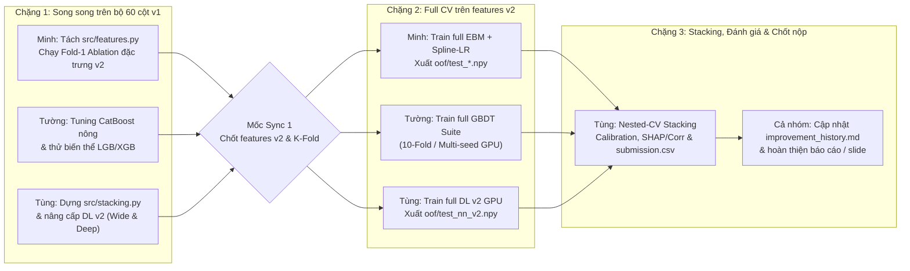

# Kế hoạch Phân công Công việc — Nhóm 3 Thành viên (Minh, Tường, Tùng)

Tài liệu phân công triển khai lộ trình cải tiến v2 (tham chiếu [ARCHITECTURE.md](ARCHITECTURE.md)) cho bài toán **Phát hiện Gian lận Thẻ tín dụng — Kaggle S6E11** từ mã nguồn hiện tại [notebooka55f0b78be.ipynb](notebooka55f0b78be.ipynb) (mốc hiện tại: **LB `0.95015`**).

---

## 1. Bảng phân công tổng quan

| Thành viên | Vai trò chính | Nhánh Git | Đầu ra kỹ thuật | Phần báo cáo / Slide phụ trách |
| :--- | :--- | :--- | :--- | :--- |
| **Minh** | **Feature Engineering, Data Pipeline & Mô hình cộng tính** | `feat/minh-fe-additive` | `src/features.py`, `feature_ablation_v2.txt`, `src/models_additive.py`, `oof/test_{ebm,spline_lr}.npy` | Bài toán, EDA, Digit-Key TE & Ablation Study |
| **Tường** | **Tối ưu họ GBDT (`CatBoost`, `LightGBM`, `XGBoost`)** | `feat/tuong-gbdt-suite` | `src/models_gbdt.py`, `oof/test_{xgb*,lgb*,cat*}.npy` | Kiến trúc Shallow Trees, Tuning & 10-Fold/Multi-seed |
| **Tùng** | **Deep Learning v2, Meta-Stacking & Tích hợp** | `feat/tung-dl-stacking` | `src/models_dl.py`, `src/stacking.py`, `oof/test_nn_v2.npy`, `submission.csv` | Tabular DL v2, Nested-CV Ensemble, Calibration & Phân tích lỗi |

---

## 2. Sơ đồ phối hợp song song



---

## 3. Danh sách đầu việc chi tiết

### 3.1. Minh — Feature Engineering, Data Pipeline & Mô hình cộng tính
*Mục tiêu: Vượt mốc Fold-1 `LGB = 0.94846` bằng bộ đặc trưng v2 sạch leakage và đóng góp 2 mô hình thuần cộng tính ít tương quan với GBDT.*

- [ ] **Chuẩn hóa Pipeline dữ liệu (`src/features.py`):**
  - Tách phần đọc dữ liệu, đồng bộ `CategoricalDtype` và `add_fold_digit_te` từ [notebooka55f0b78be.ipynb](notebooka55f0b78be.ipynb).
  - Xử lý tường minh biên `NaN` (gán bucket `-1`) và giá trị âm trong `_build_digit_keys`.
  - Cung cấp hàm chia fold dùng chung `get_folds(y, n_splits, seed=42)` để cả nhóm khớp 100% index.
- [ ] **Chạy Fold-1 Feature Ablation (cố định `LGB num_leaves=3`, lưu vào `feature_ablation_v2.txt`):**
  - Nhóm 1 (7 cột số nguyên): OOF TE + `log1p(count)` cho `customer_age`, `card_age_months`, `time_of_day_hour`, `day_of_week`, `txn_count_last_24h`, `cvv_retry_count`, `prior_disputes` + phần dư chu kỳ (`card_age_months % 12`, `customer_age % 10`).
  - Nhóm 2 (6 cột float): Exact-value TE, hàng trăm (`__hundreds`), bậc độ lớn (`exp10`), cờ làm tròn (`.00`, `.99`).
  - Nhóm 3 (Cải tiến TE): So sánh `te` thô với **`logit(te)` (WoE)** và thử `smooth` $\in \{10, 20, 50\}$ theo cardinality.
  - Nhóm 4 (Original Dataset): Kiểm tra bộ dữ liệu gốc của S6E11; nếu công khai, thử bổ sung `orig_te` trên Fold 1.
- [ ] **Chốt `features v2`** (chỉ giữ nhóm làm tăng Fold-1 ROC-AUC) và bàn giao `src/features.py` cho Tường & Tùng tại **Mốc Sync 1**.
- [ ] **Huấn luyện nhóm mô hình cộng tính (`src/models_additive.py`):**
  - Triển khai **EBM (`ExplainableBoostingClassifier` - InterpretML)** với `interactions=0` và `interactions=10`.
  - Triển khai **Spline + OneHot + Logit-TE Logistic/Ridge** (nâng cấp từ baseline [code.py](code.py)).
  - Xuất `outputs/oof_ebm.npy`, `outputs/test_ebm.npy`, `outputs/oof_spline_lr.npy`, `outputs/test_spline_lr.npy`.

---

### 3.2. Tường — Tối ưu họ GBDT (`CatBoost`, `LightGBM`, `XGBoost`)
*Mục tiêu: Đưa CatBoost từ `~0.945` lên tiệm cận `0.948+`, mở rộng đa dạng GBDT nông và chạy full CV độ ổn định cao trên Kaggle GPU.*

- [ ] **Khắc phục điểm nghẽn CatBoost (ưu tiên số 1):**
  - Thử nghiệm Fold 1 trên bộ 60 cột v1: hạ `depth` từ `4` xuống `2` và `3`; giảm `max_ctr_complexity` từ `4` xuống `1` và `2`.
  - So sánh `grow_policy="SymmetricTree"` (`depth=2..3`) với `grow_policy="Lossguide"` (`max_leaves=3..4`).
  - Chọn cấu hình CatBoost tốt nhất để đưa ngang tầm với XGB/LGB.
- [ ] **Xây dựng bộ GBDT đa dạng (`src/models_gbdt.py`):**
  - `LGB_L2`: `num_leaves=2` (thuần cộng tính, không tương tác).
  - `LGB_L3`: `num_leaves=3` (cấu hình chủ lực hiện tại).
  - `LGB_ET`: `num_leaves=3..4`, `extra_trees=True` (tăng ngẫu nhiên điểm cắt để giảm tương quan sai số).
  - `XGB_D2`: `max_depth=2` (depth-wise).
  - `XGB_LG`: `grow_policy="lossguide"`, `max_leaves=3` (leaf-wise trên XGBoost).
- [ ] **Full Training sau Mốc Sync 1 (trên `features v2` của Minh):**
  - Chạy full **10-Fold** (hoặc 5-Fold × 3 seeds `42, 2024, 2026`) trên Kaggle GPU.
  - Tính trung bình dự đoán `test` qua các fold ở **không gian logit** trước khi lưu.
  - Xuất toàn bộ `outputs/oof_{lgb_l2,lgb_l3,lgb_et,xgb_d2,xgb_lg,cat_shallow}.npy` và các file `test_*.npy` tương ứng.

---

### 3.3. Tùng — Deep Learning v2, Meta-Stacking & Tích hợp hệ thống
*Mục tiêu: Kéo điểm mạng Neural từ `~0.9418` lên `>0.946+`, xây dựng Meta-Stacker không overfit trên không gian logit và chốt `submission.csv`.*

- [ ] **Xây dựng bộ Meta-Stacking v2 (`src/stacking.py`):**
  - Thay tìm kiếm 400 mẫu Dirichlet ngẫu nhiên bằng **Nested-CV Meta-Learner** trên ma trận `oof_logit_mat`: đối chiếu `SLSQP` ($w_i \ge 0, \sum w_i = 1$), `L2 LogisticRegression`, và **Hill Climbing Ensemble Selection**.
  - Sửa lỗi log `oof_ens` khi `best_mode == "rank"` (dòng 515 của [notebooka55f0b78be.ipynb](notebooka55f0b78be.ipynb)).
  - Test trước pipeline stacking bằng các file `oof_*.npy` hiện có ngay trong Chặng 1.
- [ ] **Nâng cấp nhánh Deep Learning (`src/models_dl.py`):**
  - Tách riêng xử lý `te_*`: thay `QuantileTransformer` bằng `logit(clip(te))` + `StandardScaler` để bảo toàn thang đo log-odds.
  - Đưa trực tiếp các Digit Keys cardinality thấp/trung bình (`__cents`, `__tens`, `__ones`, `__lead`, `__tenths`, `__hundredths`) vào `nn.Embedding`.
  - Cài đặt kiến trúc **Wide & Deep** (nhánh tuyến tính cộng tính trực tiếp + nhánh Residual/PLR nhẹ) hoặc **TabM**; thử đa seed trên Kaggle GPU.
  - Sau Mốc Sync 1, chạy full CV trên `features v2` và xuất `outputs/oof_nn_v2.npy`, `outputs/test_nn_v2.npy`.
- [ ] **Tích hợp, Phân tích lỗi & Chốt nộp:**
  - Tổng hợp toàn bộ `.npy` từ Minh, Tường và Tùng để chạy Nested-CV Stacking, xuất `submission.csv` và nộp kiểm chứng trên Kaggle LB.
  - Tạo bộ biểu đồ phân tích cho báo cáo: ma trận tương quan giữa các mô hình, Reliability Curve (Calibration), Brier Score, PR-AUC và ngưỡng cắt thực tế (`Recall@FPR=0.5%`).
  - Cập nhật kết quả cuối cùng vào [improvement_history.md](improvement_history.md) và [ARCHITECTURE.md](ARCHITECTURE.md).

---

## 4. Quy ước đồng bộ bắt buộc (Interface Contract)

Để 3 thành viên ghép kết quả trong 1 bước mà không lệch dữ liệu hay lỗi shape:

1. **Dùng chung 1 bộ chia Fold duy nhất:**
   - Gọi cùng hàm `StratifiedKFold(n_splits=K, shuffle=True, random_state=42)` từ `src/features.py` của Minh.
   - Chặng 1 (thử nghiệm nhanh): dùng `K=5` (hoặc chỉ chạy Fold 1 cho ablation).
   - Chặng 2 (chạy chốt): thống nhất chung `K=10` (nếu đủ quota GPU) hoặc `K=5`.
2. **Chuẩn file trao đổi trong thư mục `outputs/`:**
   - `outputs/oof_<ten_model>.npy`: `np.ndarray`, shape `(699960,)`, `dtype=np.float64`, giá trị xác suất nằm trong `(0, 1)`.
   - `outputs/test_<ten_model>.npy`: `np.ndarray`, shape `(299984,)`, `dtype=np.float64`, trung bình các fold theo công thức:
     ```python
     test_logit += logit(np.clip(fold_test_prob, 1e-6, 1.0 - 1e-6)) / n_splits
     # Sau vòng lặp:
     test_prob = expit(test_logit)
     ```
3. **Quy tắc Commit & Ablation:**
   - Không merge đặc trưng mới hoặc cấu hình mới nếu không chứng minh được **tăng Fold-1 / OOF ROC-AUC**.
   - Mỗi PR/commit ghi rõ: `Số cột | Cấu hình | Fold-1 / OOF ROC-AUC | Thời gian chạy`.

---

## 5. Mốc đồng bộ (Sync Checkpoints)

| Mốc | Nội dung chốt | Tiêu chí hoàn thành (Definition of Done) |
| :--- | :--- | :--- |
| **Sync 1** | Khóa `features v2` & `K-Fold` | Minh merge `src/features.py` + `feature_ablation_v2.txt` (AUC tăng rõ so với 60 cột v1); Tường hoàn tất kết quả thử nghiệm CatBoost nông; Tùng hoàn tất `src/stacking.py`. |
| **Sync 2** | Đóng băng toàn bộ Base Models | Toàn bộ `outputs/oof_*.npy` và `outputs/test_*.npy` của Minh, Tường, Tùng đạt chuẩn shape và đúng thứ tự index. |
| **Sync 3** | Chốt `submission.csv` & Báo cáo | Nested-CV Ensemble vượt mốc `0.95015` trên Kaggle LB; hoàn thiện biểu đồ, tài liệu và slide thuyết trình. |
